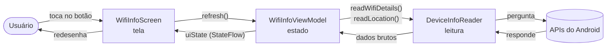
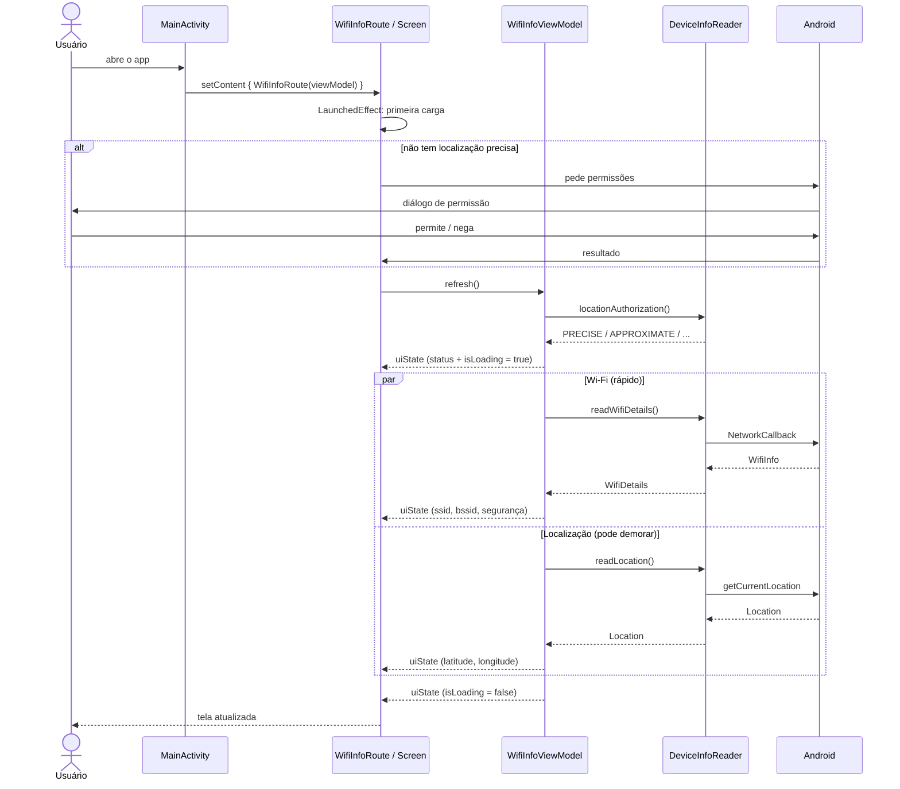
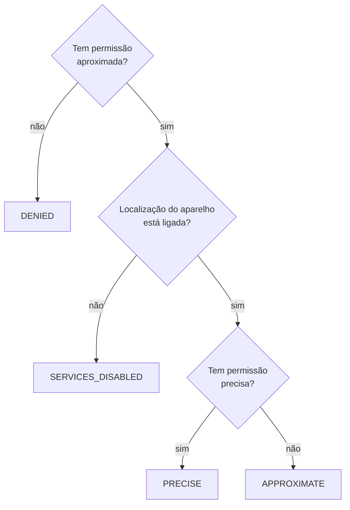
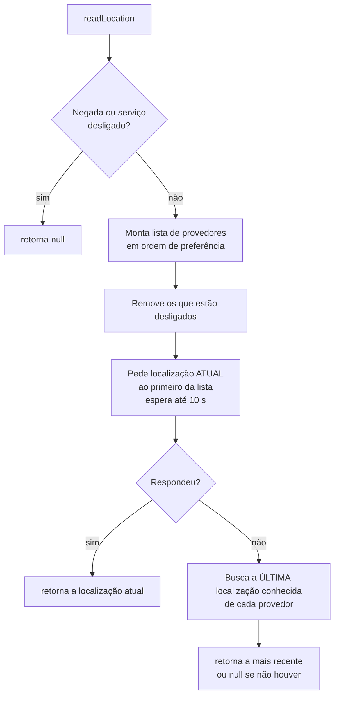

# Como o código do Safe Mode funciona

Este documento explica, passo a passo, o que o app faz e como cada arquivo colabora para isso. A ideia é que você consiga ler de cima para baixo sem precisar abrir o código — mas todo trecho aponta para o arquivo e a linha de origem, caso queira conferir.

> Ele descreve o código como está no commit `7071b2a` ("simples version"). Essa versão só **lê e mostra** dados de Wi-Fi e localização; não há lógica de "áreas confiáveis" no código atual.

## Sumário

1. [O que o app faz](#1-o-que-o-app-faz)
2. [Visão geral em 1 minuto](#2-visão-geral-em-1-minuto)
3. [Mapa dos arquivos](#3-mapa-dos-arquivos)
4. [Conceitos que você precisa conhecer](#4-conceitos-que-você-precisa-conhecer)
5. [A viagem completa: do toque no ícone até os dados na tela](#5-a-viagem-completa-do-toque-no-ícone-até-os-dados-na-tela)
6. [Arquivo por arquivo](#6-arquivo-por-arquivo)
7. [Por que a permissão de localização é necessária para ler o Wi-Fi?](#7-por-que-a-permissão-de-localização-é-necessária-para-ler-o-wi-fi)
8. [Casos especiais e o que aparece na tela](#8-casos-especiais-e-o-que-aparece-na-tela)
9. [Configuração do projeto (Gradle)](#9-configuração-do-projeto-gradle)
10. [Glossário](#10-glossário)

---

## 1. O que o app faz

O app tem **uma única tela** com seis campos somente-leitura e um botão:

```
┌──────────────────────────────────────┐
│ Wi-Fi & Location Info                │  ← barra superior
├──────────────────────────────────────┤
│ WI-FI INFORMATION                    │
│ ┌ SSID ────────────────────────────┐ │
│ │ Office-5G                        │ │  ← nome da rede
│ └──────────────────────────────────┘ │
│ ┌ BSSID ───────────────────────────┐ │
│ │ a4:91:b1:2c:7e:10                │ │  ← endereço MAC do roteador
│ └──────────────────────────────────┘ │
│ ┌ Security Type ───────────────────┐ │
│ │ WPA3 Personal                    │ │  ← tipo de segurança
│ └──────────────────────────────────┘ │
│                                      │
│ LOCATION SERVICES                    │
│ ┌ Authorization Status ────────────┐ │
│ │ Authorized When In Use           │ │  ← situação da permissão
│ └──────────────────────────────────┘ │
│ ┌ Latitude ──────┐ ┌ Longitude ────┐ │
│ │ -23,625445     │ │ -46,705629    │ │
│ └────────────────┘ └───────────────┘ │
│                                      │
│ [ ⟳ Update Wi-Fi Information ]       │  ← botão de atualizar
└──────────────────────────────────────┘
```

Ao abrir (e a cada toque no botão), o app pergunta ao Android: *"em qual Wi-Fi estou conectado?"* e *"onde estou?"*, e escreve as respostas nos campos. Quando não consegue uma resposta, o campo mostra `Unknown`.

## 2. Visão geral em 1 minuto

O código é dividido em **três camadas**, cada uma com uma única responsabilidade:

| Camada | Arquivo | Responsabilidade | Analogia |
|---|---|---|---|
| **Tela (UI)** | `WifiInfoScreen.kt` | Desenhar os campos e avisar quando o botão é tocado | O garçom: anota o pedido e traz o prato |
| **ViewModel** | `WifiInfoViewModel.kt` | Guardar o estado da tela e coordenar a busca dos dados | O chefe de cozinha: organiza o trabalho e monta o prato |
| **Leitor** | `DeviceInfoReader.kt` | Conversar com as APIs do Android (Wi-Fi e GPS) | O fornecedor: é quem realmente vai buscar os ingredientes |

A comunicação segue sempre o mesmo sentido:



Repare na regra de ouro: **eventos sobem** (tela → ViewModel → leitor) e **dados descem** (leitor → ViewModel → tela). A tela nunca fala direto com o Android para buscar dados, e o leitor não sabe que existe uma tela. Esse padrão se chama *fluxo de dados unidirecional*.

## 3. Mapa dos arquivos

```
safe-mode/
├── app/
│   ├── build.gradle.kts              ← configuração e dependências do módulo
│   └── src/main/
│       ├── AndroidManifest.xml       ← "certidão" do app: permissões e tela inicial
│       ├── java/com/poc/safemode/
│       │   ├── MainActivity.kt       ← porta de entrada (22 linhas)
│       │   ├── WifiInfoScreen.kt     ← a tela em Jetpack Compose
│       │   ├── WifiInfoViewModel.kt  ← estado e coordenação
│       │   ├── DeviceInfoReader.kt   ← leitura de Wi-Fi e localização
│       │   └── ui/theme/             ← cores, tipografia e tema (padrão do template)
│       └── res/                      ← ícones, nome do app, temas XML
├── gradle/libs.versions.toml         ← catálogo com as versões das bibliotecas
├── build.gradle.kts                  ← configuração raiz
└── settings.gradle.kts               ← lista de módulos do projeto
```

O "miolo" do app são só quatro arquivos Kotlin, com cerca de 540 linhas ao todo.

## 4. Conceitos que você precisa conhecer

Se você já domina Android moderno, pule para a [seção 5](#5-a-viagem-completa-do-toque-no-ícone-até-os-dados-na-tela).

### Jetpack Compose (UI declarativa)

No Compose você não manda a tela *mudar* ("coloque este texto naquele campo"). Você escreve uma função que **descreve** como a tela deve ficar para um determinado estado. Quando o estado muda, o Compose chama a função de novo e atualiza só o que for diferente — isso é a **recomposição**.

```kotlin
@Composable
fun Saudacao(nome: String) {   // estado entra como parâmetro
    Text("Olá, $nome")         // a função descreve a tela
}
```

### Estado e `StateFlow`

**Estado** é qualquer dado que, ao mudar, deve mudar a tela. Um `StateFlow` é uma "caixinha observável": ela sempre guarda um valor atual e avisa quem estiver observando sempre que o valor é trocado.

### ViewModel

É um objeto que **sobrevive à rotação da tela**. Quando você gira o celular, o Android destrói e recria a `Activity`; se o estado morasse nela, seria perdido. O ViewModel fica vivo durante esse processo e por isso é o lugar certo para guardar o estado.

### Corrotinas e `suspend`

Buscar a localização pode levar segundos. Se isso rodasse de forma bloqueante na thread principal, a tela travaria. Uma função `suspend` consegue **pausar sem travar a thread** e continuar depois, quando a resposta chegar. `launch { ... }` inicia uma corrotina; duas chamadas a `launch` rodam ao mesmo tempo (concorrentemente).

### Permissões em tempo de execução

Declarar a permissão no `AndroidManifest.xml` não basta para dados sensíveis como localização: o app também precisa **pedir ao usuário** com aquele diálogo do sistema, e o usuário pode negar ou conceder apenas a localização aproximada.

## 5. A viagem completa: do toque no ícone até os dados na tela

Este é o roteiro mais importante do documento. Acompanhe a sequência:



Agora em palavras:

**Passo 1 — O Android abre a `MainActivity`.**
O `AndroidManifest.xml` marca a `MainActivity` como tela de lançamento (`MAIN` + `LAUNCHER`). O Android cria a Activity e chama `onCreate`.

**Passo 2 — A Activity cria o ViewModel e monta a tela.**
Em `MainActivity.kt:11`, `by viewModels()` obtém o `WifiInfoViewModel` (cria na primeira vez, reaproveita nas rotações). Em seguida `setContent { ... }` entrega a tela ao Compose, dentro do tema `SafeModeTheme`.

**Passo 3 — A tela se desenha com o estado inicial.**
O estado inicial é `WifiInfoUiState()`, em que todos os campos valem `"Unknown"`. Por um instante é isso que aparece.

**Passo 4 — A primeira carga é disparada automaticamente.**
Um `LaunchedEffect` (`WifiInfoScreen.kt:66`) roda uma vez quando a tela entra em cena e chama `refreshOrRequestPermission()`.

**Passo 5 — Decisão: atualizar ou pedir permissão?**
Essa função (`WifiInfoScreen.kt:57`) verifica se o app já tem a permissão de **localização precisa**:
- **Tem** → chama `viewModel.refresh()` direto.
- **Não tem** → abre o diálogo de permissão do sistema. Quando o usuário responde (aceitando *ou* negando), o callback chama `viewModel.refresh()` do mesmo jeito.

**Passo 6 — O ViewModel começa o `refresh()`.**
Em `WifiInfoViewModel.kt:36`: cancela uma atualização anterior que ainda esteja rodando, descobre a situação da permissão, e publica um novo estado com esse status e `isLoading = true`. Como o botão usa `enabled = !uiState.isLoading`, ele fica desabilitado.

**Passo 7 — Wi-Fi e localização são lidos em paralelo.**
Dois `launch` são disparados ao mesmo tempo. O Wi-Fi costuma responder quase na hora; a localização pode levar segundos. Cada um atualiza a tela **assim que termina**, sem esperar o outro — por isso os campos de Wi-Fi podem aparecer antes das coordenadas.

**Passo 8 — Fim do carregamento.**
O `coroutineScope { ... }` só termina quando as duas leituras terminam. Aí o ViewModel publica `isLoading = false` e o botão volta a ficar habilitado.

**Passo 9 — O usuário toca em "Update Wi-Fi Information".**
O botão chama a mesma `refreshOrRequestPermission()` e tudo se repete a partir do passo 5.

## 6. Arquivo por arquivo

### 6.1 `AndroidManifest.xml` — a certidão do app

Declara ao sistema o que o app é e o que ele precisa. As quatro permissões (linhas 5–8):

| Permissão | Para quê | Precisa de diálogo? |
|---|---|---|
| `ACCESS_FINE_LOCATION` | Localização precisa (GPS) — e é ela que libera SSID/BSSID | Sim |
| `ACCESS_COARSE_LOCATION` | Localização aproximada | Sim |
| `ACCESS_WIFI_STATE` | Ler informações da conexão Wi-Fi | Não |
| `ACCESS_NETWORK_STATE` | Saber qual rede está ativa | Não |

Também registra a `MainActivity` como a tela que aparece no launcher.

### 6.2 `MainActivity.kt` — a porta de entrada

```kotlin
class MainActivity : ComponentActivity() {
    private val viewModel: WifiInfoViewModel by viewModels()

    override fun onCreate(savedInstanceState: Bundle?) {
        super.onCreate(savedInstanceState)
        enableEdgeToEdge()
        setContent {
            SafeModeTheme {
                WifiInfoRoute(viewModel = viewModel)
            }
        }
    }
}
```

Ela é propositalmente "burra": não tem regra nenhuma, só liga as peças.

- `by viewModels()` — cria o ViewModel atrelado ao ciclo de vida da Activity.
- `enableEdgeToEdge()` — deixa o app desenhar por baixo das barras de status e de navegação.
- `setContent { ... }` — a partir daqui a UI é Compose.

### 6.3 `WifiInfoScreen.kt` — a tela

O arquivo tem **dois composables**, e a separação entre eles é intencional:

| Composable | Sabe do ViewModel? | Papel |
|---|---|---|
| `WifiInfoRoute` | Sim | "Cola": observa o estado, cuida das permissões e da carga inicial |
| `WifiInfoScreen` | Não | Só desenha: recebe `uiState` e um callback `onUpdateClick` |

Como `WifiInfoScreen` só recebe dados prontos, dá para exibi-la no *Preview* do Android Studio com dados falsos, sem ViewModel nem celular — é exatamente o que `WifiInfoScreenPreview` faz (`WifiInfoScreen.kt:212`).

#### `WifiInfoRoute`, parte por parte

```kotlin
val uiState by viewModel.uiState.collectAsState()
```
Conecta o `StateFlow` do ViewModel ao Compose. Toda vez que o ViewModel publica um estado novo, `uiState` muda e a tela é recomposta.

```kotlin
val permissionLauncher = rememberLauncherForActivityResult(
    ActivityResultContracts.RequestMultiplePermissions(),
) { viewModel.refresh() }
```
Prepara o "lançador" do diálogo de permissões. O bloco entre chaves é executado **quando o usuário responde ao diálogo**. Ele chama `refresh()` sem olhar o resultado — o próprio `refresh()` vai reler a situação da permissão e mostrar `Denied` se for o caso.

```kotlin
val refreshOrRequestPermission = {
    val hasFineLocation = ContextCompat.checkSelfPermission(
        context, Manifest.permission.ACCESS_FINE_LOCATION,
    ) == PackageManager.PERMISSION_GRANTED
    if (hasFineLocation) viewModel.refresh() else permissionLauncher.launch(locationPermissions)
}
```
A decisão do passo 5. O app pede `FINE` e `COARSE` juntas porque, do Android 12 em diante, o diálogo deixa o usuário escolher entre "Precisa" e "Aproximada".

```kotlin
var initialLoadDone by rememberSaveable { mutableStateOf(false) }
LaunchedEffect(Unit) {
    if (!initialLoadDone) {
        initialLoadDone = true
        refreshOrRequestPermission()
    }
}
```
Faz a carga inicial **uma única vez**. O detalhe está no `rememberSaveable`: ao girar o celular, a Activity é recriada e o `LaunchedEffect` rodaria de novo; como `initialLoadDone` sobrevive à rotação, o `if` impede que o diálogo de permissão reapareça ou que os dados sejam recarregados à toa.

#### `WifiInfoScreen`, a estrutura visual

```
Scaffold                         ← esqueleto: barra superior + conteúdo
├─ TopAppBar  "Wi-Fi & Location Info"
└─ Column                        ← ocupa a tela toda
   ├─ Column (weight 1f, rolável) ← pega todo o espaço que sobrar
   │  ├─ Text  "WI-FI INFORMATION"
   │  ├─ OutlinedTextField  SSID
   │  ├─ OutlinedTextField  BSSID
   │  ├─ OutlinedTextField  Security Type
   │  ├─ Text  "LOCATION SERVICES"
   │  ├─ OutlinedTextField  Authorization Status
   │  └─ Row
   │     ├─ OutlinedTextField  Latitude   (weight 1f)
   │     └─ OutlinedTextField  Longitude  (weight 1f)
   └─ Button  "Update Wi-Fi Information"   ← sempre fixo no rodapé
```

Pontos que valem atenção:

- **`weight(1f)` na coluna interna** faz ela ocupar todo o espaço restante, empurrando o botão para o rodapé. Em telas pequenas, só a parte de cima rola (`verticalScroll`); o botão continua visível.
- **`weight(1f)` em Latitude e Longitude** divide a linha meio a meio.
- Os campos são `OutlinedTextField` com `readOnly = true` e `onValueChange = {}`: têm a aparência de campo de texto, mas o usuário não consegue editar.
- **`innerPadding`** vem do `Scaffold` e evita que o conteúdo fique escondido atrás da barra superior e das barras do sistema.
- **`enabled = !uiState.isLoading`** desabilita o botão durante a busca.

### 6.4 `WifiInfoViewModel.kt` — o estado e o maestro

#### O estado da tela

```kotlin
data class WifiInfoUiState(
    val ssid: String = UNKNOWN,
    val bssid: String = UNKNOWN,
    val securityType: String = UNKNOWN,
    val authorizationStatus: String = UNKNOWN,
    val latitude: String = UNKNOWN,
    val longitude: String = UNKNOWN,
    val isLoading: Boolean = false,
)
```

Uma única classe descreve **tudo** o que a tela mostra. Todos os campos já são `String` prontas para exibir: a tela não formata nem decide nada, só mostra. É uma classe **imutável** (`val`), então para "alterar" um campo cria-se uma cópia com `copy(...)`.

#### O par `_uiState` / `uiState`

```kotlin
private val _uiState = MutableStateFlow(WifiInfoUiState())
val uiState: StateFlow<WifiInfoUiState> = _uiState.asStateFlow()
```

Padrão clássico: a versão **mutável** é privada (só o ViewModel escreve) e a versão **somente-leitura** é pública (a tela só lê). Assim a tela não tem como bagunçar o estado.

#### A função `refresh()`

```kotlin
fun refresh() {
    refreshJob?.cancel()                               // (1)
    refreshJob = viewModelScope.launch {               // (2)
        _uiState.update {                              // (3)
            it.copy(
                authorizationStatus = reader.locationAuthorization().label(),
                isLoading = true,
            )
        }
        coroutineScope {                               // (4)
            launch { /* lê o Wi-Fi e atualiza ssid, bssid, securityType */ }
            launch { /* lê a localização e atualiza latitude, longitude */ }
        }
        _uiState.update { it.copy(isLoading = false) } // (5)
    }
}
```

1. **Cancela a atualização anterior**, se ainda estiver rodando. Evita que uma resposta atrasada sobrescreva uma mais nova.
2. **`viewModelScope.launch`** inicia uma corrotina que é cancelada automaticamente quando o ViewModel é destruído (o usuário saiu do app) — nada fica "vazando" em segundo plano.
3. **Primeira atualização, imediata**: status da permissão + `isLoading = true`.
4. **Leituras em paralelo.** `coroutineScope` espera os dois `launch` terminarem antes de seguir adiante.
5. **Fim**: `isLoading = false`.

Por que `_uiState.update { it.copy(...) }` e não uma simples atribuição? Porque as duas corrotinas escrevem no mesmo estado. O `update` lê o valor atual e aplica a mudança de forma atômica, então a corrotina do Wi-Fi nunca apaga o que a da localização escreveu (e vice-versa).

#### Funções auxiliares

- **`orNullIfRevoked`** (`WifiInfoViewModel.kt:74`) — o usuário pode revogar a permissão nas configurações entre a checagem e a leitura. Nesse caso o Android lança `SecurityException`; esta função a transforma em `null`, e o campo mostra `Unknown` em vez de o app fechar.
- **`LocationAuthorization.label()`** — traduz o enum para o texto exibido:

  | Enum | Texto na tela |
  |---|---|
  | `DENIED` | Denied |
  | `SERVICES_DISABLED` | Location Services Disabled |
  | `APPROXIMATE` | Authorized When In Use (Approximate) |
  | `PRECISE` | Authorized When In Use |

- **`formatCoordinate()`** — formata com 6 casas decimais (precisão de cerca de 10 cm) usando o idioma do aparelho. Por isso, num celular em português, aparece `-23,625445` com **vírgula**.

### 6.5 `DeviceInfoReader.kt` — quem fala com o Android

É a única classe que conhece as APIs do sistema. Ela usa três "gerentes" do Android:

| Gerente | Usado para |
|---|---|
| `ConnectivityManager` | Descobrir a rede ativa e receber o `WifiInfo` |
| `WifiManager` | Caminho antigo (Android 11 e anteriores) |
| `LocationManager` | Obter a localização |

Repare em `context.applicationContext` (`DeviceInfoReader.kt:41`): guardar o contexto da *aplicação*, e não o da Activity, evita vazamento de memória, já que o leitor vive dentro do ViewModel e dura mais que a Activity.

#### `locationAuthorization()` — qual é a situação da permissão?

```kotlin
fun locationAuthorization(): LocationAuthorization = when {
    !hasPermission(ACCESS_COARSE_LOCATION)  -> DENIED
    !isLocationEnabled(locationManager)     -> SERVICES_DISABLED
    hasPermission(ACCESS_FINE_LOCATION)     -> PRECISE
    else                                    -> APPROXIMATE
}
```

O `when` testa de cima para baixo e para na primeira condição verdadeira:



Note que são duas coisas diferentes: a **permissão do app** (o usuário autorizou *este* app) e o **serviço de localização** (o botão "Localização" do aparelho está ligado).

#### `readWifiDetails()` — lendo o Wi-Fi

O Android mudou a forma de ler Wi-Fi no Android 12, então há dois caminhos:

```kotlin
suspend fun readWifiDetails(): WifiDetails? =
    if (Build.VERSION.SDK_INT >= Build.VERSION_CODES.S) {   // Android 12+
        readWifiInfo()?.let { info -> WifiDetails(...) }
    } else {
        readWifiDetailsLegacy()                             // Android 7 a 11
    }
```

Retorna `null` quando o aparelho não está conectado a nenhum Wi-Fi.

**Caminho moderno (Android 12+) — `readWifiInfo()`** (`DeviceInfoReader.kt:118`)

A partir do Android 12, o sistema **esconde** o SSID e o BSSID, a menos que o `WifiInfo` venha de um `NetworkCallback` registrado com a flag `FLAG_INCLUDE_LOCATION_INFO`. O código faz assim:

1. Cria um `CompletableDeferred<WifiInfo>` — uma "promessa" que será preenchida depois.
2. Cria um `NetworkCallback` com a flag. Quando o sistema chama `onCapabilitiesChanged`, o código extrai o `WifiInfo` e completa a promessa.
3. Registra o callback pedindo apenas redes do tipo Wi-Fi.
4. Espera a promessa por **até 2 segundos** (`withTimeoutOrNull`). Sem Wi-Fi conectado o callback nunca é chamado — o tempo limite impede que o app fique esperando para sempre e faz a função devolver `null`.
5. No `finally`, **sempre** cancela o registro do callback, tenha dado certo ou não.

Isso é uma técnica comum: transformar uma API baseada em *callback* em uma função `suspend` que simplesmente "retorna o valor".

**Caminho antigo (Android 7 a 11) — `readWifiDetailsLegacy()`** (`DeviceInfoReader.kt:142`)

1. Confere se a rede ativa é Wi-Fi; se não for, devolve `null`.
2. Lê `wifiManager.connectionInfo` (API hoje obsoleta, daí o `@Suppress("DEPRECATION")`).
3. Nessas versões o `WifiInfo` não informa o tipo de segurança. O código então procura, nos resultados da última varredura de redes (`scanResults`), a rede com o mesmo BSSID e lê o texto de `capabilities` — algo como `[WPA2-PSK-CCMP][ESS]`.

**Limpando os valores "falsos"**

Quando o app não tem permissão, o Android não lança erro: ele devolve **valores de mentira**. Duas funções de extensão os convertem em `null`:

| Valor devolvido pelo sistema | Significa | Função |
|---|---|---|
| `<unknown ssid>` | SSID oculto | `toSsidOrNull()` |
| `02:00:00:00:00:00` | BSSID oculto | `toBssidOrNull()` |

`toSsidOrNull()` também remove as aspas que o Android coloca em volta do nome (`"Office-5G"` → `Office-5G`).

**Traduzindo o tipo de segurança**

- `securityTypeLabel(Int)` — Android 12+: converte a constante numérica em texto legível (`SECURITY_TYPE_SAE` → `WPA3 Personal`).
- `securityTypeFromCapabilities(String)` — versões antigas: procura palavras-chave no texto de `capabilities`. A ordem dos testes importa: `SAE` (WPA3) é verificado antes de `PSK` (WPA2), porque redes em modo misto anunciam os dois e queremos reportar o mais forte.

#### `readLocation()` — lendo a localização



Os **provedores** são as fontes de localização, tentadas nesta ordem:

| Ordem | Provedor | Quando entra na lista | Característica |
|---|---|---|---|
| 1 | `FUSED_PROVIDER` | Android 12+ | Combina GPS, Wi-Fi e antenas; melhor custo-benefício |
| 2 | `NETWORK_PROVIDER` | Sempre | Wi-Fi e antenas de celular; rápido, menos preciso |
| 3 | `GPS_PROVIDER` | Só com permissão **precisa** | Satélites; preciso, lento e ruim em ambientes fechados |

A estratégia tem dois níveis:

1. **Localização atual**: pede uma leitura nova ao melhor provedor disponível, com limite de 10 segundos.
2. **Plano B**: se não chegar a tempo (por exemplo, GPS dentro de um prédio), usa a última localização que o sistema já conhecia, escolhendo a mais recente entre os provedores (`maxByOrNull { it.time }`).

A função `currentLocation()` (`DeviceInfoReader.kt:99`) usa a mesma ideia do Wi-Fi — transformar callback em `suspend` — desta vez com `suspendCancellableCoroutine`. Se a corrotina for cancelada (o usuário saiu da tela ou o tempo limite estourou), `invokeOnCancellation` avisa o Android para parar de procurar a localização, economizando bateria.

### 6.6 `ui/theme/` — a aparência

São os arquivos gerados pelo template do Android Studio, praticamente sem alteração:

- `Color.kt` — as cores roxas padrão.
- `Type.kt` — a tipografia.
- `Theme.kt` — `SafeModeTheme`, que escolhe o esquema de cores. No Android 12+ usa **cores dinâmicas** (extraídas do papel de parede do usuário); em versões anteriores usa as cores de `Color.kt`. Em ambos os casos respeita o modo claro/escuro do sistema.

## 7. Por que a permissão de localização é necessária para ler o Wi-Fi?

É a dúvida mais comum sobre este app, e a resposta explica boa parte das decisões do código.

O nome e o endereço MAC de um roteador **revelam onde você está**. Existem bancos de dados públicos que mapeiam BSSIDs para coordenadas geográficas; quem souber em qual roteador seu celular está conectado sabe, na prática, em que lugar você se encontra. Por isso o Android trata SSID e BSSID como **dados de localização**.

Consequências diretas no código:

| Regra do Android | Onde aparece no código |
|---|---|
| Só libera SSID/BSSID com localização **precisa** | `refreshOrRequestPermission` pede `ACCESS_FINE_LOCATION` antes de atualizar |
| Exige o serviço de localização **ligado** | `locationAuthorization()` distingue `SERVICES_DISABLED` |
| No Android 12+, exige `FLAG_INCLUDE_LOCATION_INFO` | `readWifiInfo()` usa `NetworkCallback` com essa flag |
| Sem permissão, devolve valores falsos em vez de erro | `toSsidOrNull()` e `toBssidOrNull()` |

O **tipo de segurança** não é dado de localização, então ele pode aparecer preenchido mesmo quando SSID e BSSID estão como `Unknown`.

## 8. Casos especiais e o que aparece na tela

| Situação | SSID / BSSID | Security Type | Authorization Status | Latitude / Longitude |
|---|---|---|---|---|
| Tudo permitido, conectado ao Wi-Fi | Preenchidos | Preenchido | Authorized When In Use | Preenchidas |
| Usuário negou a permissão | Unknown | Preenchido (Android 12+) | Denied | Unknown |
| Concedeu só localização aproximada | Unknown | Preenchido (Android 12+) | Authorized When In Use (Approximate) | Preenchidas (imprecisas) |
| Localização do aparelho desligada | Unknown | Preenchido (Android 12+) | Location Services Disabled | Unknown |
| Sem Wi-Fi (só dados móveis) | Unknown | Unknown | conforme a permissão | Preenchidas |
| Sem sinal de localização (ex.: subsolo) | Preenchidos | Preenchido | Authorized When In Use | Última conhecida, ou Unknown |

Outros comportamentos:

- **Tocar várias vezes no botão** — o botão fica desabilitado durante a busca e, além disso, `refresh()` cancela a busca anterior antes de começar outra.
- **Girar o celular** — o ViewModel sobrevive, então os dados continuam na tela; `initialLoadDone` impede uma recarga desnecessária.
- **Sem localização precisa** — como o botão sempre verifica a permissão *precisa*, cada toque tenta abrir o diálogo de novo. Depois que o usuário nega duas vezes, o Android para de exibir o diálogo e responde "negado" automaticamente; o app apenas atualiza e mostra o status. Não há atalho para as configurações do sistema.
- **Permissão revogada no meio da leitura** — `orNullIfRevoked` captura a `SecurityException` e o campo vira `Unknown`.

## 9. Configuração do projeto (Gradle)

Do arquivo `app/build.gradle.kts`:

| Configuração | Valor | Significado |
|---|---|---|
| `applicationId` | `com.poc.safemode` | Identificador único do app |
| `minSdk` | 24 | Roda do Android 7.0 em diante |
| `targetSdk` / `compileSdk` | 37 | Versão do Android para a qual foi feito |
| `buildFeatures.compose` | `true` | Habilita o Jetpack Compose |
| Java | 11 | Versão do bytecode |

O `minSdk = 24` é o motivo de existirem os dois caminhos de leitura de Wi-Fi: o app precisa funcionar tanto antes quanto depois do Android 12 (API 31).

As bibliotecas ficam centralizadas em `gradle/libs.versions.toml` (o *version catalog*): as versões são declaradas em um único lugar e referenciadas como `libs.androidx.core.ktx` no `build.gradle.kts`. As principais:

- **Compose BOM + Material 3** — a UI. O BOM garante que todas as bibliotecas do Compose usem versões compatíveis entre si.
- **activity-compose** — `setContent`, `viewModels()` e o lançador de permissões.
- **core-ktx** — `ContextCompat` e `LocationManagerCompat`, que escondem diferenças entre versões do Android.
- **lifecycle-runtime-ktx** — integração com o ciclo de vida.

O app **não usa** Google Play Services: a localização vem do `LocationManager` da própria plataforma, então funciona também em aparelhos sem os serviços do Google.

Os testes em `src/test` e `src/androidTest` são apenas os exemplos gerados pelo template; ainda não há testes da lógica do app.

## 10. Glossário

| Termo | Significado |
|---|---|
| **SSID** | Nome da rede Wi-Fi, o que aparece na lista de redes |
| **BSSID** | Endereço MAC do ponto de acesso; identifica o roteador físico |
| **WPA2 / WPA3** | Padrões de segurança do Wi-Fi (o WPA3 é o mais novo) |
| **Activity** | Uma tela do app, do ponto de vista do Android |
| **Composable** | Função anotada com `@Composable` que descreve um pedaço da UI |
| **Recomposição** | Quando o Compose reexecuta um composable porque o estado mudou |
| **ViewModel** | Guarda o estado da tela e sobrevive à rotação |
| **StateFlow** | Valor observável: guarda o estado atual e avisa quando muda |
| **Corrotina** | Tarefa leve que pode ser pausada sem travar a thread |
| **`suspend`** | Marca uma função que pode pausar e continuar depois |
| **Callback** | Função que você entrega para ser chamada mais tarde |
| **Provedor de localização** | Fonte da posição: GPS, rede ou fused |
| **API level / SDK** | Número da versão do Android (24 = Android 7.0, 31 = Android 12) |
